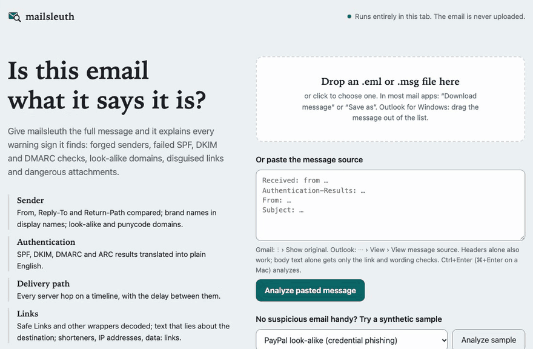
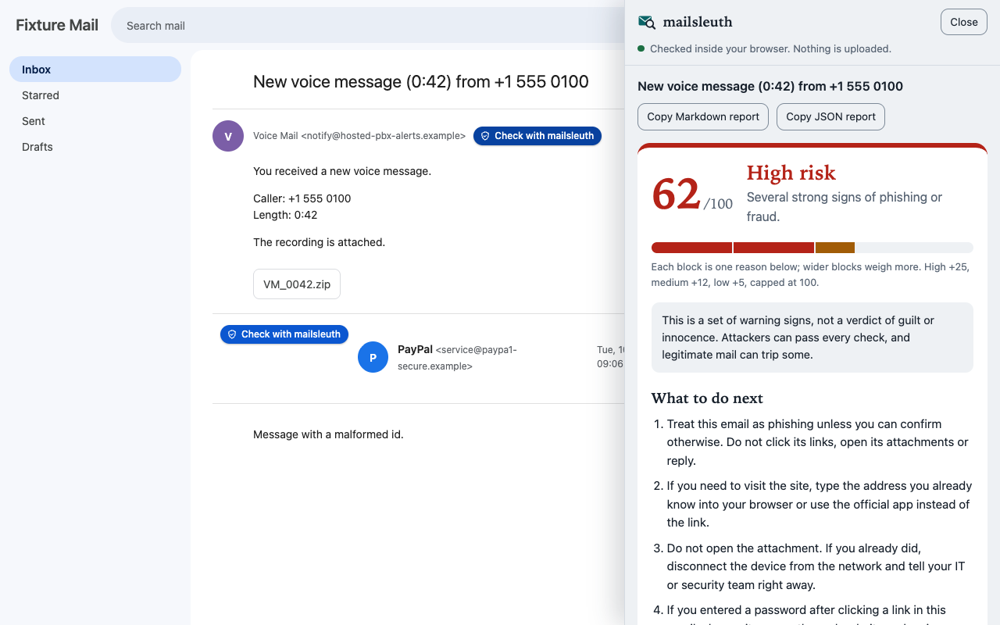

# mailsleuth

**A suspicious-email analyzer that explains every warning sign in plain English, and never lets the email leave your browser.**

Drop in an `.eml` or Outlook `.msg` file (or paste the source) and get forged senders, failed SPF/DKIM/DMARC, look-alike domains, disguised links (including the ones hidden inside an attached PDF, HTML or Office file, or in a file inside an attached ZIP) and risky attachments, each with the evidence it found and what to do next. The same core runs as a JSON CLI for scripting.



Built for regular people who want a second opinion on one email, and for SOC beginners who need to triage user-reported phishing and learn what each header means. It gives a score with reasons, never a verdict: passing every check does not make a message honest.

## Use it inside Gmail

A browser extension adds a small blue **Check with mailsleuth** button to the sender line of each open email in Gmail on the web. One click shows the full result in a panel next to the email: score, risk level, every reason with its evidence, links, and attachment hashes with VirusTotal and MalwareBazaar lookup buttons. No exporting, no pasting.



It is not in the Chrome Web Store or Firefox Add-ons; load it yourself (about a minute):

```sh
git clone https://github.com/Habibeyilmazz/mailsleuth.git
cd mailsleuth
npm ci
npm run build:extension   # writes dist-extension/ and mailsleuth-extension-chrome.zip / -firefox.zip
```

1. Open `chrome://extensions` (Edge: `edge://extensions`, Brave: `brave://extensions`).
2. Turn on **Developer mode** (top right).
3. Click **Load unpacked** and choose the `dist-extension` folder.
4. Reload Gmail, open an email, click **Check with mailsleuth** next to the sender's name. Escape or **Close** hides the panel.

Without Node: every CI run on `main` uploads the same build as the `mailsleuth-extension` artifact (Actions tab, needs a GitHub login); unzip `mailsleuth-extension-chrome.zip` and load that folder. Firefox 128+: `about:debugging#/runtime/this-firefox` › **Load Temporary Add-on** › pick `mailsleuth-extension-firefox.zip`; this build exists but has not been tested in Firefox.

The toolbar button opens the same checker for an `.eml` or `.msg` file you choose (any webmail, Outlook files included). Popups close when you switch to another app, so to drag a file in, use its "Open this checker in a tab" link.

**What it touches.**

- It runs only on `https://mail.google.com/*` and asks for no other permissions: no tabs, storage, history, cookies or background worker. Chrome describes this as "Read and change your data on mail.google.com".
- Nothing happens until you click. The click makes one request: Gmail's own "Download message" link for that email (`/mail/u/0/?view=att&permmsgid=…&attid=0&disp=comp&safe=1&zw`), from the Gmail tab, with the login that tab already has. No OAuth, no Google API key, no Google Cloud project. Gmail answers that link with a redirect to its attachment host, `mail-attachment.googleusercontent.com`; the extension accepts a response only from that host or `mail.google.com`, and your Gmail cookies go only to `mail.google.com`.
- The message goes straight to the extension's own panel page, which runs the same analysis as the web page. That page's Content-Security-Policy has `connect-src 'none'`, so it cannot send anything anywhere. Nothing is stored; closing the panel discards it.
- As on the web page, text from the email is shown as plain text only, links are defanged and never clickable, and the lookup buttons send only a hash or link, and only if you click them.

**How it was tested, and what can break.** The Gmail part was tested against a synthetic page that copies the parts of Gmail's markup the extension uses ([test/fixtures/gmail/thread.html](test/fixtures/gmail/thread.html)), loaded in Chromium as `https://mail.google.com` by Playwright, not against real Gmail: no Gmail account was used. It reads the same attributes and download link that the long-lived [Gmail.js](https://github.com/KartikTalwar/gmail.js) library uses, but Gmail's page structure is undocumented and changes without notice. If the button stops appearing, or the panel says Gmail sent a web page instead of the message, the fix belongs in [src/extension/gmail.ts](src/extension/gmail.ts), the one file with Gmail-specific code; please open an issue. Outlook on the web is not supported yet (see [Roadmap](#roadmap)).

## Quickstart

Needs Node.js 22.12 or newer (what Vite and Vitest require; CI uses Node 22) and about 30 seconds.

```sh
git clone https://github.com/Habibeyilmazz/mailsleuth.git
cd mailsleuth
npm ci
npm run dev          # web app on http://localhost:4190
```

Then, on the start page:

- **Just looking?** Pick one of the ten synthetic samples (look-alike domain, macro invoice, CEO gift cards, a link hidden in a PDF, a Word file that loads a remote template, a voicemail ZIP with a sign-in page inside, a clean newsletter for contrast, and more).
- **Your own email:** drop or choose its `.eml` or Outlook `.msg` file, or paste the message source (Gmail: ⋮ › Show original; Outlook: ⋯ › View › View message source). In Outlook for Windows you can drag a message from the list straight onto the page.
- **Only part of it?** Headers alone work; body text alone (no headers) gets only the link and wording checks. Files saved with a byte order mark, as UTF-16, or with CR-only line endings are read too.
- **Only the attachment?** A PDF, image, archive or program dropped on its own is refused rather than rated: analyze the email it came in, which also gives the file's SHA-256 for a lookup.

There is no hosted copy yet; `npm run build` gives a static `dist/` you can serve yourself (see [Static build](#static-build)).

More screenshots: [start page](docs/screenshots/home.png), [a full result](docs/screenshots/result.png), [an Outlook .msg file](docs/screenshots/msg-result.png), [a link hidden in a PDF attachment](docs/screenshots/pdf-link-result.png), [a Word file that loads a remote template](docs/screenshots/office-template-result.png), [a sign-in page inside a ZIP](docs/screenshots/zip-result.png), [phone, dark mode](docs/screenshots/mobile-result-dark.png), [the Gmail panel's reasons](docs/screenshots/extension-gmail-reasons.png), [the extension popup with a .msg file](docs/screenshots/extension-popup.png).

### Command line

```sh
npm run build:cli
node dist-cli/mailsleuth.js samples/01-paypal-lookalike.eml          # pretty JSON
node dist-cli/mailsleuth.js samples/07-outlook-sign-request.msg       # Outlook .msg works the same way
cat message.eml | node dist-cli/mailsleuth.js --compact - | jq '.score, .level, [.findings[].id]'
node dist-cli/mailsleuth.js --markdown samples/06-user-report-forwarded.eml > report.md   # for a ticket
```

Real output for the CEO gift-card sample, trimmed with `jq`:

```console
$ node dist-cli/mailsleuth.js --compact samples/04-ceo-gift-cards.eml \
    | jq '{score, level, findings: [.findings[] | "\(.severity) +\(.points)  \(.title)"]}'
{
  "score": 59,
  "level": "high",
  "findings": [
    "high +25  The sender name shows a different email address",
    "medium +12  Replies would go to a different domain",
    "medium +12  Mentions payments, gift cards or bank-detail changes",
    "low +5  Pressure to act quickly or quietly",
    "low +5  Delivery timestamps go backwards"
  ]
}
```

### Markdown report for a ticket

"Copy Markdown report" on the result page, or `--markdown` in the CLI (the two give the same text), writes a report you can paste into a ticket, a chat or case notes: score and verdict, sender, every reason with its evidence, authentication, delivery path, links, attachments with SHA-256, an "Observables" block (sender domains, link hosts and URLs, hashes of attachments and of the files inside attached ZIPs, one per line) and what to do next. An attached email gets its own report one heading level down. Links and domains are defanged (`hxxps://evil[.]example`), and all text taken from the email is put in code spans, so a display name such as `[Support](https://…)` or an `` in a subject cannot turn into a live link or image where the report is rendered. Like the page, it lists at most 200 items per section and says how many the JSON report has beyond that.

```console
$ node dist-cli/mailsleuth.js --markdown samples/04-ceo-gift-cards.eml | head -12
# Email report: `Quick favour - are you at your desk?`

**Score 59/100: High risk.** Several strong signs of phishing or fraud.

Warning signs, not a verdict: attackers can pass every check, and legitimate mail can trip some.

## Message

- From: `Dana Whitfield <dana.whitfield@northwind-traders.example> <ceo.office.dw@quickmail-hub.example>`
- Reply-To: `dwhitfield.exec@secure-reply.example`
- Return-Path: `ceo.office.dw@quickmail-hub.example`
- To: `Sam Okafor <sam.okafor@northwind-traders.example>`
```

The JSON contains the score, level, every finding (title, explanation, evidence), the parsed authentication results, delivery hops, links (`attachment` names the file a link came from; `archive.zip › folder/page.html` for a file inside an attached ZIP), attachments with SHA-256 (and `zipHashes` for the files inside a ZIP), and the full analysis of any attached email. The exit code is 0 whenever an analysis was printed, whatever the risk level, and 2 for unreadable, empty, oversized or non-email input or bad options (`--compact` with `--markdown`) (with a one-line message on stderr), so scripts should read `.level` or `.score` rather than the exit code.

### Static build

```sh
npm run build        # web app in dist/, CLI in dist-cli/
npm run preview      # serves dist/ on http://localhost:4191
```

`dist/` is a plain static site with relative paths; open it from any web server (opening `index.html` straight from disk does not work, because browsers block module scripts on `file://`). A manual GitHub Pages workflow is included (`.github/workflows/pages.yml`, run it from the Actions tab once Pages is set to "GitHub Actions").

## What it checks

| Area | Checks |
| --- | --- |
| Sender | From vs Reply-To vs Return-Path domains; more than one From address; a different email address hidden in the display name; brand names in the display name on a non-brand domain (also spelled with look-alike letters, or a capital I for l as in "PaypaI"); official-sounding names on free webmail |
| Domains | Look-alikes of 44 bundled brands: homoglyphs from Cyrillic/Greek, digit swaps (paypa1), one-letter typos, brand names inside someone else's domain (paypal.com.evil.example); punycode (`xn--`) decoded and shown; domain endings often seen in abuse reports |
| Authentication | SPF, DKIM, DMARC, ARC and Microsoft `compauth` from `Authentication-Results`, each explained in plain English; DMARC alignment; only the topmost header is trusted, and only when its server matches the newest `Received` hop (a header without a server name only behind a Microsoft 365 hop); earlier ones are shown as unverifiable |
| Delivery path | Every `Received` hop on a timeline with the delay since the previous hop; timestamps that go backwards are flagged |
| Links | Text that shows one site while linking to another (a file name such as `Report.pdf` is not a site, and the sender's own site behind a known mailing service's click tracking, such as Mailchimp or SendGrid, is a note rather than a warning); an email address shown over a `mailto:` link to another domain; Microsoft Safe Links, Proofpoint URL Defense (v2/v3), Google and Facebook redirects unwrapped before checking; shorteners; bare and disguised IP addresses (`http://3325256727/`); `user@host` tricks; `data:`, `javascript:` and `vbscript:` links; `file:` links, `\\server\share` paths and Windows handlers such as `search-ms:` and `ms-msdt:` (they open a share or a program; a share can receive the Windows login hash); open redirects; direct links to risky file types. Links inside PDF, HTML and Office attachments, and inside those files in an attached ZIP, get the same checks and are marked with the file they came from (see below) |
| Attachments | SHA-256 of each file, including files uuencoded into the message text (`begin 644 name`, which Thunderbird still shows as an attachment); type detected from content, not the name; VBA macros found by structure (OOXML `vbaProject.bin`, OLE `_VBA_PROJECT`); double extensions; hidden right-to-left characters; executables and scripts, ISO/IMG/VHD, LNK, OneNote, HTML/SVG; ZIP contents listed, risky entries and password protection flagged, and each file in the ZIP unpacked (one level, at most 32 MB) for its SHA-256 and the same content checks (a macro document, a PDF with a Launch action, a program named `.jpg`); password-protected Office documents; content that does not match the extension; in PDFs: JavaScript, Launch actions (start a program), embedded files, and encryption that hides the PDF's links; in Word/Excel/PowerPoint files: templates or objects loaded from a web address when the file opens (template injection, "Follina") |
| Links inside attachments | The "your document is attached" lure keeps the email itself clean and puts the real link in the attachment. mailsleuth reads link actions (`/URI`) from PDFs, both in plain objects and in the compressed object streams most current PDF writers use, and from HTML/SVG attachments it takes `<a>` links, form targets, and every bare URL in the file (script redirects, `<meta>` refreshes), and from Word/Excel/PowerPoint files every external link their relationship parts declare. The same goes for such files inside an attached ZIP (the "voicemail.zip with a player page" lure), one level deep. Each appears under Links with "Inside the attachment …" (`VM.zip › Play.html` for a file in a ZIP), and a note lists how many links each file has |
| Language | English phrases for credential phishing, money requests (gift cards, bank-detail changes), urgency/secrecy and threats; every match is quoted |
| Forwarded reports | An email attached as `message/rfc822`, as any file named `.eml`, or as an Outlook `.msg` file (how users report phishing) gets its own full analysis; in the UI, "Analyze attached email" opens it |
| Outlook `.msg` | Read without Outlook: the internet headers Outlook kept, every stored body (plain text, HTML, and compressed RTF, including HTML encapsulated in it as in most `.msg` files; all are checked because Outlook may show any of them), attachments and attached messages. The message is rebuilt as MIME and goes through every check above. Without stored internet headers (drafts, sent items, some internal mail), the sender, recipients and subject Outlook stored are used and the report says that authentication could not be checked. A damaged file (broken sector chain, failed RTF checksum) is refused rather than half-read |

Each finding adds points by severity (high 25, medium 12, low 5, capped at 100): 0–19 is low risk, 20–49 suspicious, 50+ high risk. The page shows each finding's share of the score, what it means, the exact evidence, things in the email's favour, and what to do next. It never says an email is safe or malicious: passing every check does not make a message honest, and legitimate mail can trip some checks.

## Privacy

- No network requests. The built page ships a Content-Security-Policy with `connect-src 'none'`, so the browser itself blocks any attempt to send data; CI checks the policy is present.
- No fonts, analytics or CDNs are loaded.
- Links in the email are shown defanged (`hxxps://evil[.]example`) and are never clickable.
- Invisible text-direction characters (U+202A-202E, U+2066-2069) from the email are shown as markers like `⟨U+202E⟩` instead of reordering what you read; the CLI and "Copy JSON report" write them, and C1 control characters, as `\uXXXX` escapes.
- The Gmail extension makes exactly one request, to `mail.google.com`, when you click its button, and its pages cannot make any (see [Use it inside Gmail](#use-it-inside-gmail)).
- The VirusTotal, URLhaus and MalwareBazaar buttons are ordinary links that you choose to click. They send only that one URL, host name or hash to that service, never the email.

## How it works

```
src/core/      shared by web and CLI, no dependencies
  mime.ts        MIME parser: header unfolding, RFC 2047/2231, multipart, base64/QP
  received.ts    Received headers -> ordered hops with delays
  auth.ts        Authentication-Results / ARC parser and plain-English explanations
  domains.ts     registrable domain, brand look-alike and homoglyph detection
  punycode.ts    RFC 3492 decoder
  msg.ts         Outlook .msg: Compound File reader, MAPI properties, compressed RTF, HTML-in-RTF -> MIME
  urls.ts        link extraction, wrapper unwrapping, link tricks
  attachments.ts magic-byte sniffing, ZIP central directory, macro detection
  pdf.ts         PDF link actions, JavaScript/Launch/embedded-file markers, Flate object streams
  office.ts      Word/Excel/PowerPoint external links and remote templates from _rels/*.rels
  language.ts    phrase patterns
  analyze.ts     runs everything, scores, writes next steps
  report.ts      defanged Markdown report (page button and CLI --markdown)
src/web/       vanilla TypeScript UI (DOM built with textContent only); view.ts is the result view, shared with the extension
src/extension/ browser extension: gmail.ts (every Gmail-specific hook), content.ts (button, download), panel.ts (analysis and view)
extension/     extension manifest, icons and panel page
src/cli.ts     Node CLI
samples/       synthetic emails, generated by scripts/make-samples.ts
```

Raw input is kept as a byte-per-character string so MIME offsets stay exact; text is decoded per part with `TextDecoder`. SHA-256 uses Web Crypto and PDF object streams are inflated with `DecompressionStream`, both available in browsers and Node. The only dependencies are dev tools (Vite, Vitest, TypeScript, Playwright).

## When to use something else

mailsleuth is a local first look at one message. Other tools do some jobs better:

| Tool | What it is | Use it instead when |
| --- | --- | --- |
| [Microsoft Message Header Analyzer](https://github.com/microsoft/MHA) | Open-source header viewer from Microsoft, as a web page and an Outlook add-in | You are in Outlook / Microsoft 365 and want Microsoft's own anti-spam headers decoded; it reads headers only, not links or attachments |
| [Google Admin Toolbox Messageheader](https://toolbox.googleapps.com/apps/messageheader/) | Paste headers, see hops, delays and SPF/DKIM/DMARC | You only have headers and want a quick second view from Google's side |
| [eml_analyzer](https://github.com/ninoseki/eml_analyzer) | Open-source web app you host, analyzes `.eml` bodies, attachments and indicators | You want automatic reputation lookups (VirusTotal, urlscan.io and others) and are fine sending indicators to those services |
| A malware sandbox (for example ANY.RUN, Joe Sandbox, CAPE) | Opens attachments and links in an instrumented machine | You need to know what an attachment or page actually does. mailsleuth never opens, runs or fetches anything |
| Your mail provider's "Report phishing" button | Sends the message to the people who can block the sender | Always, in addition to any analysis. At work, follow your security team's reporting process first |

What mailsleuth adds: the whole message (headers, body, links and attachment structure) in one report, `.msg` support without Outlook, every point of the score explained, and no network access at all, so it is usable on mail you may not upload anywhere.

## Samples

`samples/` holds ten synthetic emails written for this project: a PayPal look-alike with a Safe Links-wrapped punycode link, an invoice with a macro document and an HTML attachment, a clean newsletter, a CEO gift-card request, a parcel notice full of link tricks, a user report that forwards the first one as an attachment, a fake signature request saved as an Outlook `.msg` file (body stored as compressed RTF, like most real ones), and a calm "here is the rate sheet" email that passes SPF, DKIM and DMARC and whose only link, to a Microsoft look-alike, is inside the attached PDF (in a compressed object stream, written by `scripts/pdf.ts`), and an equally calm "updated contract" whose Word file has no macro but loads its template from a web server, with a reply address shown over a `mailto:` link to a look-alike domain, and a "new voice message" notice with no links whose ZIP holds an HTML "player" that is really a sign-in form posting to a Microsoft look-alike. The `.msg` sample is written by `scripts/msg.ts`; Python's `extract-msg` reads it with the same subject, headers, HTML and attachment hash. All domains are reserved (`.example`, `example.net`), all IPs are from documentation ranges, and the attachments contain only placeholder text. One sample links to a `bit.ly` path made up for this project to demonstrate shortener detection; the app never makes it clickable. Regenerate them with `node scripts/make-samples.ts` (Node 22.18+).

## Development

```sh
npm run typecheck
npm test                 # Vitest unit and end-to-end tests on the samples
npm run fuzz             # timing fuzz: hostile 60 KB inputs must each analyze in under 500 ms (about a minute)
npm run build
npm run build:cli && npm run build:extension
npm run e2e:extension    # loads the unpacked extension in Chromium on a fake Gmail page; add -- --screenshots to redo the extension screenshots
npm run e2e -- chromium   # main journey (samples, file picker, paste) served from /mailsleuth/ like Pages; page must match the CLI; axe-core accessibility check, light and dark
npm run screenshots      # drives the built app in Chromium (Playwright), fails on console errors or external requests
npm run demo             # re-records docs/demo.gif from the built app (needs ffmpeg)
```

CI runs `npm run e2e` in Chromium, Firefox and WebKit (Playwright's builds, not the Safari app), with the browser set to a non-UTC time zone, runs the extension test in Chromium, and uploads the extension zips as a workflow artifact (never to a store).

## Limitations

- Brand list, abused-TLD list and multi-label suffixes (`co.uk`) are small hand-curated lists, not the full Public Suffix List or Unicode confusables table.
- HTML is scanned with regular expressions, not a DOM parser; badly malformed markup can hide a link.
- Ten mailing services' click trackers are known (Mailchimp, SendGrid, HubSpot, Amazon SES and others in `src/core/data.ts`). A newsletter sent through another service, with its own site as the link text, is still reported as "Link text shows one site but goes to another".
- Language checks are English only.
- ZIP archives are unpacked one level deep (stored and deflated entries, at most 32 MB and 500 files per archive): a ZIP inside a ZIP is not unpacked (only risky file names in it are flagged), and RAR, 7-Zip, gzip and encrypted ZIP entries are not opened, so their contents are neither hashed nor searched for links. In Office documents the link targets are read but not the text shown over them, so a text/link mismatch inside a document is not flagged.
- PDFs are scanned for link actions, not parsed in full: an encrypted PDF (including the common kind that opens without a password) is reported as encrypted but its links cannot be read; a link stored as an indirect reference, in a PDF form's submit action, or written only as page text or in a QR code image is missed. JavaScript in an HTML attachment is not run, so a link it builds at run time (from `atob(...)` or string pieces) is missed.
- `.msg` files: OLE-object and by-reference (cloud link) attachments are named in the report but not extracted, and the SHA-256 of an email attached inside a `.msg` is of the rebuilt MIME copy, not of any original file. Ordinary attachments hash exactly as in the `.eml`.
- `Received` headers below your own provider can be forged; the timeline shows them as written.
- A `Received` date without a time zone, or with a zone name RFC 5322 does not define (such as `CET` without a numeric offset), shows as "no readable date" rather than a guess.
- At most 20,000 distinct links are checked per email (its own links first, then those in attachments); beyond that the report says how many were left out and counts it as a warning sign. A 10 MB email of 450,000 distinct links takes about 0.6 s and 380 MB in the CLI.
- The page lists at most 200 headers, hops, links, attachments, MIME parts, ZIP entries or evidence lines per section and says how many it left out; findings and "Copy JSON report" cover all of them.
- The Gmail button depends on Gmail's undocumented page structure and download link, and was tested on a page that mimics them, not on Gmail itself. The Firefox build is untested.
- Authentication results are only counted in the email's favour when the checking server matches the newest `Received` hop. Setups where a separate filtering service checks mail before an internal server (or Gmail's "by" an IP address only, followed by a different host) can show genuine results as unverified; that removes a reassurance but never adds points.

## Roadmap

Ideas, not promises; the order is roughly what would help most.

- A hosted copy: the manual Pages workflow is ready, Pages just has to be switched on for the repository
- Outlook on the web. Not in the extension, because there is no clean way for a browser extension to get the raw message there: Microsoft Graph (`/me/messages/{id}/$value`) needs an Azure app registration and OAuth consent, the older Outlook REST API has been retired, and Outlook's own internal web calls are undocumented and change without notice, so using them would be exactly the kind of hack that breaks silently. The supported route is an Outlook add-in calling `Office.context.mailbox.item.getAsFileAsync()` (Mailbox requirement set 1.14, returns the open message as EML, no Azure app needed), a separate project with its own manifest. Until then, save the message (⋯ › Download, or drag it out of Outlook for Windows) and use the extension's popup or the web page
- Publishing the extension in the Chrome Web Store and Firefox Add-ons
- Opening RAR and 7-Zip archives, and ZIPs nested in ZIPs
- Reading links in encrypted PDFs that open without a password (needs MD5/RC4 for older PDFs and AES for newer ones)
- QR codes in images and PDFs ("scan to sign in"), which needs an image decoder in the browser
- Full Public Suffix List and a larger confusables table
- More languages for the phrase checks

## Contributing

Bug reports, missed or wrong findings, and small focused pull requests are welcome; [CONTRIBUTING.md](CONTRIBUTING.md) has the setup and the few rules (every parser change gets a test, every new regex goes through `npm run fuzz`). **Never attach a real email to an issue**: rebuild the trick in a synthetic message with `example` domains, as the samples do.

Security problems in mailsleuth itself (something that makes data leave the page, runs script from an email, or freezes the tab): see [SECURITY.md](SECURITY.md).

## License

[MIT](LICENSE) © Habibeyilmazz
