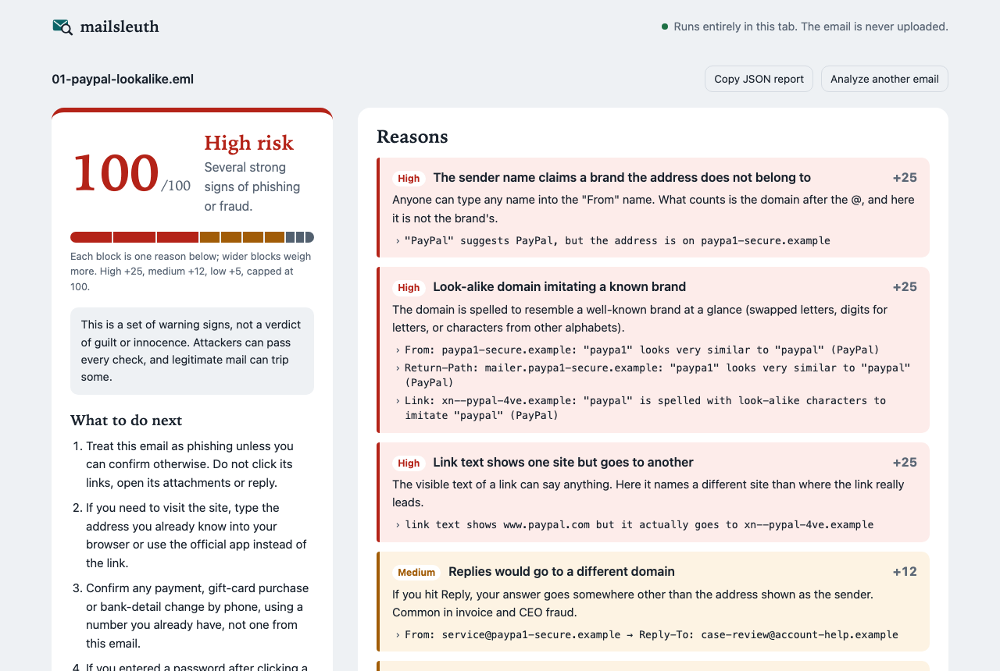

# mailsleuth


Drop in a suspicious email and get every warning sign explained in plain English: forged senders, failed SPF/DKIM/DMARC, look-alike domains, disguised links and dangerous attachments.
It runs entirely in your browser (or as a JSON CLI), so the email never leaves your machine.



Built for regular people who want a second opinion on one email, and for SOC beginners who need to triage user-reported phishing and learn what each header means.

## Quickstart

Needs Node.js 20 or newer.

```sh
git clone https://github.com/Habibeyilmazz/mailsleuth.git
cd mailsleuth
npm ci
npm run dev          # web app on http://localhost:4190
```

Pick one of the synthetic samples on the start page, drop your own `.eml` file, or paste the message source (Gmail: ⋮ › Show original; Outlook: ⋯ › View › View message source). Headers alone also work; body text alone (no headers) gets only the link and wording checks.

More screenshots: [start page](docs/screenshots/home.png), [phone, dark mode](docs/screenshots/mobile-result-dark.png).

### Command line

```sh
npm run build:cli
node dist-cli/mailsleuth.js samples/01-paypal-lookalike.eml          # pretty JSON
cat message.eml | node dist-cli/mailsleuth.js --compact - | jq '.score, .level, [.findings[].id]'
```

The JSON contains the score, level, every finding (title, explanation, evidence), the parsed authentication results, delivery hops, links, attachments with SHA-256, and the full analysis of any email attached as `message/rfc822`.

### Static build

```sh
npm run build        # web app in dist/, CLI in dist-cli/
```

`dist/` is a plain static site with relative paths; open it from any web server. A manual GitHub Pages workflow is included (`.github/workflows/pages.yml`, run it from the Actions tab once Pages is set to "GitHub Actions").

## What it checks

| Area | Checks |
| --- | --- |
| Sender | From vs Reply-To vs Return-Path domains; a different email address hidden in the display name; brand names in the display name on a non-brand domain; official-sounding names on free webmail |
| Domains | Look-alikes of 44 bundled brands: homoglyphs from Cyrillic/Greek, digit swaps (paypa1), one-letter typos, brand names inside someone else's domain (paypal.com.evil.example); punycode (`xn--`) decoded and shown; domain endings often seen in abuse reports |
| Authentication | SPF, DKIM, DMARC, ARC and Microsoft `compauth` from `Authentication-Results`, each explained in plain English; DMARC alignment; only the topmost header is trusted, earlier ones are shown as unverifiable |
| Delivery path | Every `Received` hop on a timeline with the delay since the previous hop; timestamps that go backwards are flagged |
| Links | Text that shows one site while linking to another; Microsoft Safe Links, Proofpoint URL Defense (v2/v3), Google and Facebook redirects unwrapped before checking; shorteners; bare and disguised IP addresses (`http://3325256727/`); `user@host` tricks; `data:` and `javascript:` links; open redirects; direct links to risky file types |
| Attachments | SHA-256 of each file; type detected from content, not the name; VBA macros found by structure (OOXML `vbaProject.bin`, OLE `_VBA_PROJECT`); double extensions; hidden right-to-left characters; executables and scripts, ISO/IMG/VHD, LNK, OneNote, HTML/SVG; ZIP contents listed, risky entries and password protection flagged; content that does not match the extension |
| Language | English phrases for credential phishing, money requests (gift cards, bank-detail changes), urgency/secrecy and threats; every match is quoted |
| Forwarded reports | An email attached as `message/rfc822` (how users report phishing) gets its own full analysis; in the UI, "Analyze attached email" opens it |

Each finding adds points by severity (high 25, medium 12, low 5, capped at 100): 0–19 is low risk, 20–49 suspicious, 50+ high risk. The page shows each finding's share of the score, what it means, the exact evidence, things in the email's favour, and what to do next. It never says an email is safe or malicious: passing every check does not make a message honest, and legitimate mail can trip some checks.

## Privacy

- No network requests. The built page ships a Content-Security-Policy with `connect-src 'none'`, so the browser itself blocks any attempt to send data; CI checks the policy is present.
- No fonts, analytics or CDNs are loaded.
- Links in the email are shown defanged (`hxxps://evil[.]example`) and are never clickable.
- The VirusTotal, URLhaus and MalwareBazaar buttons are ordinary links that you choose to click. They send only that one URL, host name or hash to that service, never the email.

## How it works

```
src/core/      shared by web and CLI, no dependencies
  mime.ts        MIME parser: header unfolding, RFC 2047/2231, multipart, base64/QP
  received.ts    Received headers -> ordered hops with delays
  auth.ts        Authentication-Results / ARC parser and plain-English explanations
  domains.ts     registrable domain, brand look-alike and homoglyph detection
  punycode.ts    RFC 3492 decoder
  urls.ts        link extraction, wrapper unwrapping, link tricks
  attachments.ts magic-byte sniffing, ZIP central directory, macro detection
  language.ts    phrase patterns
  analyze.ts     runs everything, scores, writes next steps
src/web/       vanilla TypeScript UI (DOM built with textContent only)
src/cli.ts     Node CLI
samples/       synthetic emails, generated by scripts/make-samples.ts
```

Raw input is kept as a byte-per-character string so MIME offsets stay exact; text is decoded per part with `TextDecoder`. SHA-256 uses Web Crypto, available in both browsers and Node. The only dependencies are dev tools (Vite, Vitest, TypeScript, Playwright).

## Samples

`samples/` holds six synthetic emails written for this project: a PayPal look-alike with a Safe Links-wrapped punycode link, an invoice with a macro document and an HTML attachment, a clean newsletter, a CEO gift-card request, a parcel notice full of link tricks, and a user report that forwards the first one as an attachment. All domains are reserved (`.example`, `example.net`), all IPs are from documentation ranges, and the attachments contain only placeholder text. One sample links to a `bit.ly` path made up for this project to demonstrate shortener detection; the app never makes it clickable. Regenerate them with `node scripts/make-samples.ts` (Node 22.18+).

## Development

```sh
npm run typecheck
npm test                 # Vitest unit and end-to-end tests on the samples
npm run build
npm run screenshots      # drives the built app in Chromium (Playwright), fails on console errors or external requests
```

## Limitations

- Brand list, abused-TLD list and multi-label suffixes (`co.uk`) are small hand-curated lists, not the full Public Suffix List or Unicode confusables table.
- HTML is scanned with regular expressions, not a DOM parser; badly malformed markup can hide a link.
- Language checks are English only.
- Attachments are inspected, not decompressed: macros inside nested archives, PDF JavaScript and remote-template tricks in Office files are not detected.
- `Received` headers below your own provider can be forged; the timeline shows them as written.

## Roadmap

- Office remote-template and PDF JavaScript/launch-action detection (needs inflate via `DecompressionStream`)
- Full Public Suffix List and a larger confusables table
- `.msg` (Outlook) file support
- More languages for the phrase checks
- Exporting a defanged analyst report (Markdown) from the UI

## License

[MIT](LICENSE) © Habibeyilmazz
